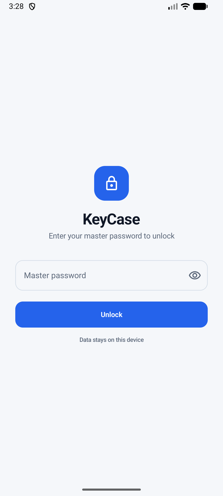
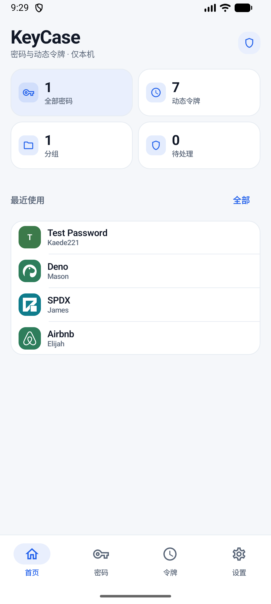
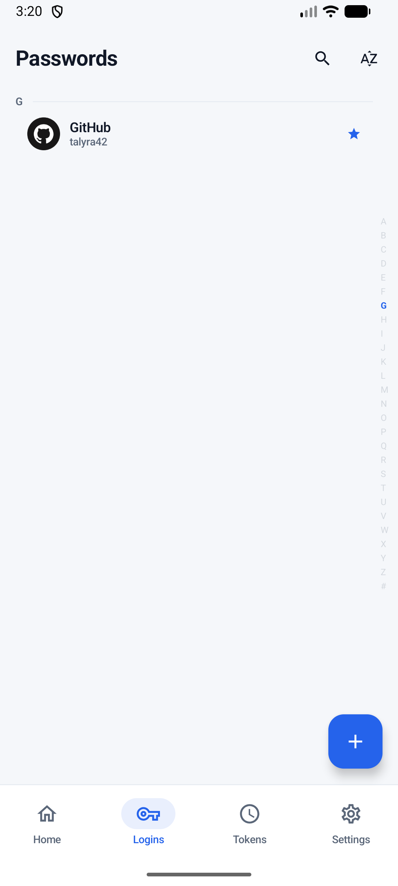
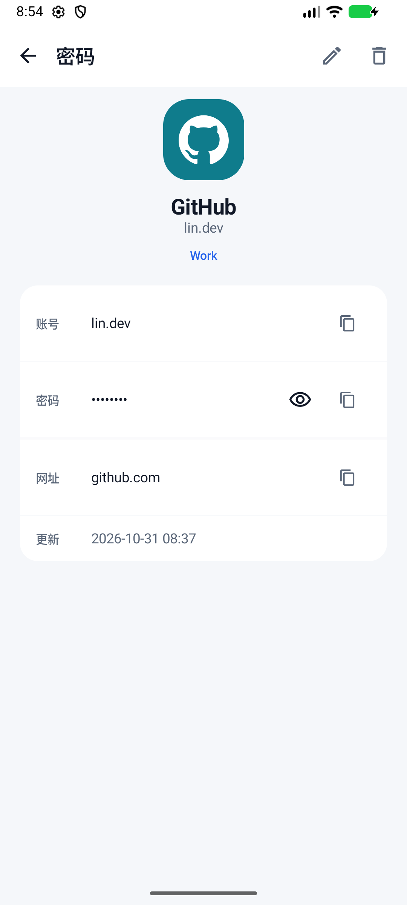
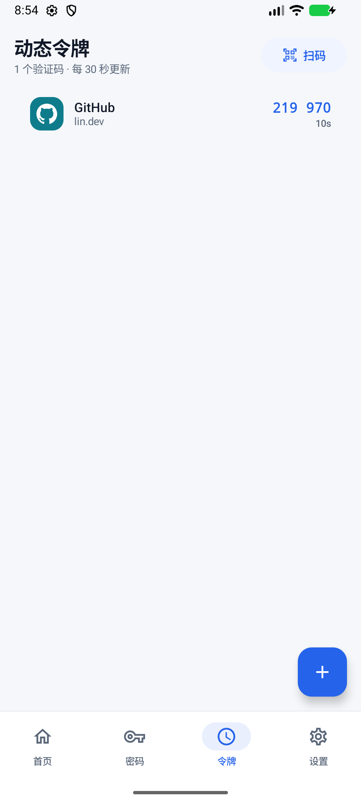
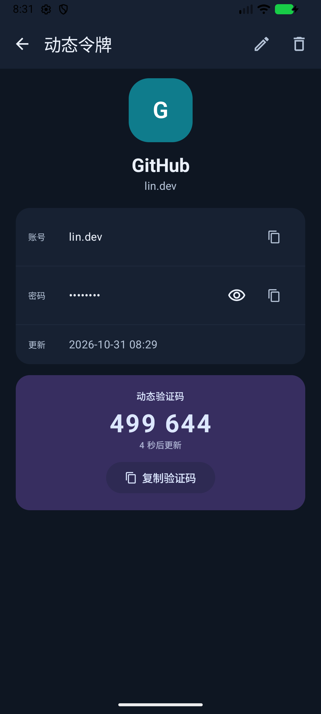
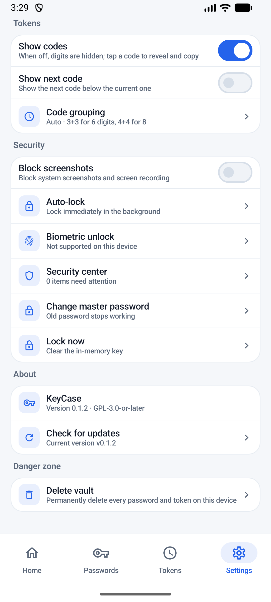
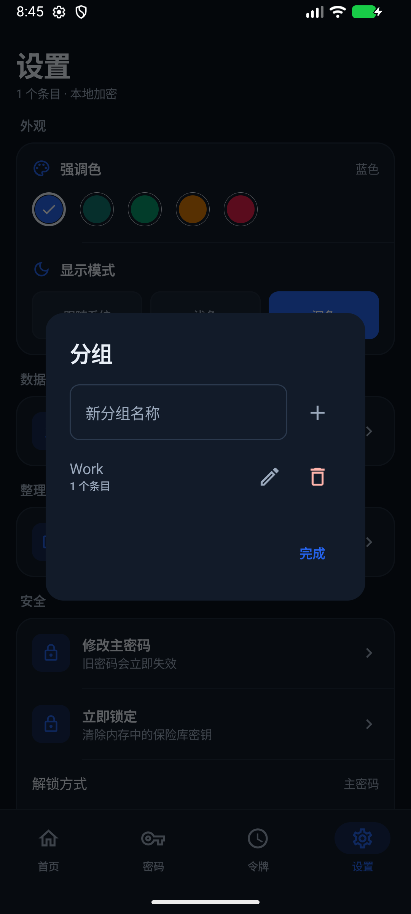
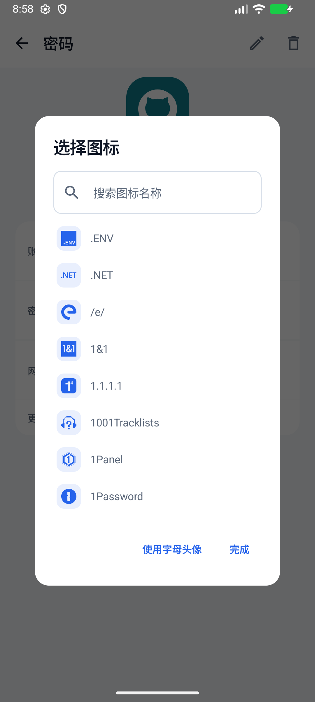

# KeyCase

**Local-first, offline Android password manager and TOTP authenticator.**
No account, no cloud, **no `INTERNET` permission**.

> Status: working debug build. Create/unlock, password CRUD, TOTP codes, QR scanning, groups, accent/dark theme, custom colors, encrypted backup export/import, master-password rotation, auto-lock, Aegis icon matching, and an explicit icon picker are implemented and verified on an Android 37 emulator. Biometric unlock, Aegis/Google Authenticator import, and imported icon packs are still planned.

## What it is

KeyCase keeps two kinds of items in one local, encrypted vault:

- **Passwords** — accounts, passwords, URLs, notes, groups.
- **Dynamic tokens (TOTP)** — scanned QR codes or manually entered secrets, with codes generated on-device.

The app is built for Android and is intentionally offline. There is no sync server, no account system, and no telemetry.

## Principles

- The vault is encrypted on the device; the master password never leaves it.
- The app declares **no `INTERNET` permission**, so it cannot upload data.
- Backups are explicit, encrypted files written to a folder the user chooses, and can be imported back.
- Data is portable: import/export the encrypted container now; Aegis/Google Authenticator import is planned.

## Documentation

- [Design decisions v0.5](docs/design/design-decisions-v0.5.md)
- [UI redesign notes](docs/design/ui-redesign.md)
- [Vault container format v1](docs/design/vault-format-v1.md)
- [Research notes](docs/design/research.md)
- [Clickable prototype](docs/prototype/index.html)
- [Archived early plans](docs/archive/)

## Screenshots

| | |
|---|---|
|  |  |
| Unlock with the master password | Home stats and recent items |
|  |  |
| Passwords with Aegis icon matching | Password detail |
|  |  |
| TOTP list with live codes and QR scan | TOTP detail |
|  |  |
| Settings, grouped rows | Dark mode |
|  |  |
| Group management | Icon picker |

## Build

Requirements: Android Studio (with its bundled JBR), Android SDK, JDK 17+.

```powershell
# Windows
$env:JAVA_HOME = "C:\Program Files\Android\Android Studio\jbr"
.\gradlew.bat assembleDebug
```

Tests:

```powershell
.\gradlew.bat :core:test :app:testDebugUnitTest
# with an emulator/device running:
.\gradlew.bat :app:connectedDebugAndroidTest
```

`local.properties` is machine-specific and is not committed.

Current baseline:

- `applicationId` / `namespace`: `top.talyra42.keycase`
- `minSdk`: 26
- `compileSdk` / `targetSdk`: 37
- Kotlin + Jetpack Compose + Material 3

## Project layout

```
app/                 Android app shell
core/                pure-JVM vault, crypto, TOTP, importers
docs/                design notes and the HTML prototype
gradle/              version catalog and wrapper
```

The `:core` module is deliberately free of Android APIs so its security-critical logic can be tested on the JVM. The Android layer (`app/`) owns files, QR scanning, and UI.

## Icon packs

The built-in icon pack is [Aegis Simple Icons](https://github.com/alexbakker/aegis-simple-icons), derived from [Simple Icons](https://simpleicons.org/). Simple Icons are CC0; brand logos remain trademarks of their owners. The pack is stored at `app/src/main/assets/iconpacks/aegis-simple-icons-v269.zip`.

The app reads `pack.json`, matches an item's title/issuer against the pack's issuer list, and renders the matching SVG path into a Compose `ImageVector`; unmatched items use the first-character avatar. The avatar pencil in the detail screen opens a searchable picker over the built-in pack. Importing user packs is still planned.

## License

GPL-3.0-or-later. See [LICENSE](LICENSE).
