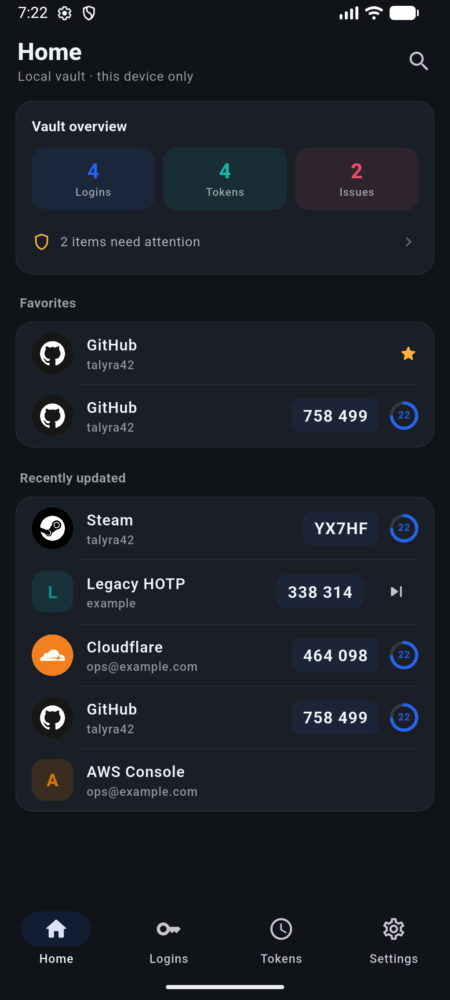

# KeyCase

**Local-first, offline password manager and TOTP authenticator for Android.**

No account, no cloud, no telemetry, no network permission at all. Everything lives in one
encrypted container on the device; the master password never leaves it.

> Status: **v1.0.0** — Flutter rewrite of the original Kotlin app. Create/unlock, biometric
> unlock with master-password fallback, password CRUD, TOTP/HOTP/Steam codes, QR scanning,
> global search, favorites, trash, security center, Aegis icon matching, encrypted backups,
> automatic snapshots, theme accents and light/dark modes.

## Principles

- **Encrypted at rest.** The vault is `AES-256-GCM` ciphertext; the vault key is wrapped by a
  key derived from the master password with `Argon2id` (64 MiB, 3 iterations, p=2).
- **Nothing leaves the device.** The app declares no `INTERNET` permission and contains no
  analytics, sync or crash reporting.
- **No plaintext on disk.** Passwords and TOTP secrets only exist in memory while unlocked and
  inside the encrypted container. Backups are encrypted container copies.
- **Portable data.** Export/import the encrypted container at any time; scan standard
  `otpauth://` QR codes.

## Features

| Area | What you get |
|---|---|
| Vault | create with master password, unlock, auto-lock on leaving the app, lock now |
| Security | Argon2id key derivation, AES-256-GCM, `FLAG_SECURE` option, biometric unlock via Android Keystore |
| Logins | account / password / URL / notes, random password generator, copy-to-clipboard |
| Tokens | TOTP, HOTP (with counter), Steam; one shared ticker, per-row countdown ring |
| Lists | A–Z grouping, search across names/accounts/URLs/notes, favorites, sorting menu |
| Icons | built-in Aegis Simple Icons pack, automatic brand matching, letter fallback |
| Data | encrypted export/import, 10 rotating snapshots after each save, trash with restore |
| Appearance | system/light/dark, five accent presets, custom color, Chinese/English |

## Screenshots

| | |
|---|---|
|  |  |
| Home, light | Home, dark |
|  |  |
| Logins with A–Z groups and brand icons | Tokens with shared countdown |
|  |  |
| Token detail | Settings |

## Build

Requirements: Flutter 3.47.2 (same as CI), Java 17, Android SDK.

```bash
flutter pub get
flutter run -d emulator-5554
flutter build apk --release      # signed with signing/keycase-release.jks
```

```bash
dart format .
flutter analyze
flutter test
```

## Release

Signed releases are built by GitHub Actions from a `vX.Y.Z` tag:

```bash
dart run scripts/publish.dart patch
```

The script bumps `pubspec.yaml` + `lib/app/app_version.dart`, runs format/analyze/test,
commits, tags and pushes. CI builds the APK with `signing/keycase-release.jks` and creates a
**prerelease**; promote it to latest after installing on a device.

## Project layout

```
lib/app/        models, vault container + repository, crypto, OTP, icons, controller, theme
lib/pages/      screens; every modal/sheet/dialog entry lives in pages/sheets.dart
lib/common_widgets.dart  shared widgets (parts under lib/app/common_widgets_*.dart)
lib/l10n/       Chinese (template) and English ARB files + generated localizations
android/        MainActivity with the single MethodChannel bridge (Keystore, FLAG_SECURE)
assets/iconpacks/  Aegis Simple Icons pack (SVG + pack.json)
docs/           design system, component registry, architecture and technical decisions
```

## Security notes

- `allowBackup="false"`: Android never copies the vault into a cloud backup.
- Biometric unlock stores the vault key encrypted by an Android Keystore key; the plaintext key
  only exists during an unlock.
- The master password cannot be recovered. Export a backup before changing it.

Report issues via GitHub Issues. Licensed GPL-3.0-or-later.
