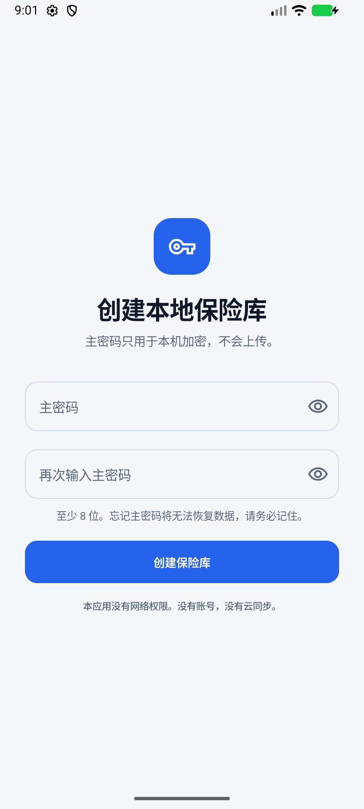
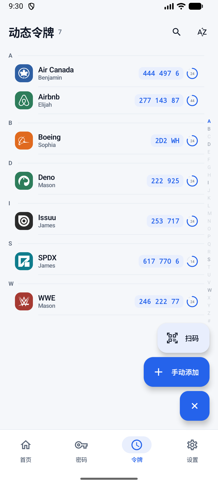
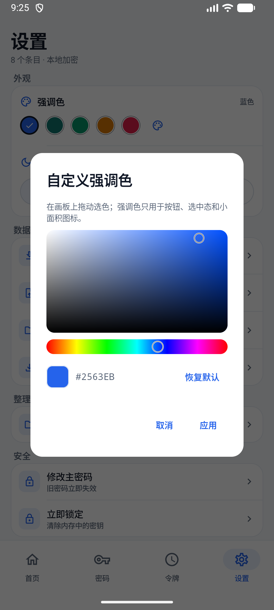

# KeyCase

**Local-first, offline-first Android password manager and TOTP authenticator.**
No account, no cloud, no telemetry. The only network request is the optional, user-triggered GitHub update check.

> Status: **v0.1.1** signed release, built by GitHub Actions and installed on a physical Android device. Create/unlock, biometric unlock with master-password fallback, password CRUD, TOTP codes, QR scanning, global search, trash, security center, accent/dark theme, visual color picker, manual and automatic encrypted backups, Aegis vault import, Google Authenticator migration import, master-password rotation, auto-lock, Aegis icon matching, imported bitmap icon packs, a searchable icon picker, custom image icons, B3 launcher icon, and manual GitHub update check are implemented. UI copy follows the device language (Chinese/English).

## What it is

KeyCase keeps two kinds of items in one local, encrypted vault:

- **Passwords** — accounts, passwords, URLs, notes.
- **Dynamic tokens (TOTP)** — scanned QR codes or manually entered secrets, with codes generated on-device.

The app is built for Android and is local-first. There is no sync server, no account system, and no telemetry. The only optional network request is the manual “Check for updates” action.

## Principles

- The vault is encrypted on the device; the master password never leaves it.
- The app has no cloud sync, accounts, analytics, or telemetry. `INTERNET` is declared only for the manual “Check for updates” button, which reads the public GitHub release feed.
- Backups are encrypted snapshots written to a folder the user chooses, manually or automatically after each save, and can be imported back.
- Data is portable: import/export the encrypted container, merge Aegis TOTP exports, and import Google Authenticator migration links.

## Documentation

- [Agent guide](AGENTS.md)
- [Design system](DESIGN.md)
- [App icon: B3 obsidian](docs/icon-options/b3-obsidian.svg)
- [Design decisions v0.5](docs/design/design-decisions-v0.5.md)
- [UI redesign notes](docs/design/ui-redesign.md)
- [Vault container format v1](docs/design/vault-format-v1.md)
- [Research notes](docs/design/research.md)
- [Clickable prototype](docs/prototype/index.html)
- [Archived early plans](docs/archive/)

## Screenshots

| | |
|---|---|
|  |  |
| Create a local vault | Unlock with the master password |
|  |  |
| Home, compact cards | Home, dark mode |
|  |  |
| Passwords with A–Z index | Password detail |
|  |  |
| TOTP list with A–Z index | TOTP detail |
|  |  |
| Scan / manual add FAB | Visual accent color picker |
|  |  |
| Settings, compact rows | Settings, dark mode |
|  | |
| Icon picker | |

## Build

Requirements: Android Studio (with its bundled JBR), Android SDK, JDK 17+.

```powershell
# Windows
$env:JAVA_HOME = "C:\Program Files\Android\Android Studio\jbr"
.\gradlew.bat assembleDebug
```

## Release

Signed release builds are produced by GitHub Actions. The release keystore and
its properties are intentionally committed under `signing/` so the key cannot be
lost between machines; this is a public open-source project and the owner accepts
that anyone with repository access can sign builds.

- Keystore: `signing/keycase-release.jks`
- Properties: `signing/keystore.properties`
- SHA-256: `ccd20e5c3165668bf0b5732e3cff2dcfb445fb622bd820742c3cf37f9aa28ba7`

Cut a release from `main` with one command:

```powershell
.\scripts\release.ps1 patch   # or minor / major
```

It bumps `versionCode`/`versionName`, commits the version, creates and pushes
`vX.Y.Z`, and GitHub Actions builds, signs, and publishes the APK. Release notes
contain only the compare link between the previous and current tag.

## Tests

```powershell
.\gradlew.bat :core:test :app:testDebugUnitTest
# with an emulator/device running:
.\gradlew.bat :app:connectedDebugAndroidTest
```

`local.properties` is machine-specific and is not committed.

Current baseline:

- `applicationId` / `namespace`: `top.talyra42.keycase`
- `minSdk`: 26
- `compileSdk` / `targetSdk`: 37
- Kotlin + Jetpack Compose + Material 3

## Project layout

```
app/                 Android app shell
core/                pure-JVM vault, crypto, TOTP, importers
docs/                design notes and the HTML prototype
gradle/              version catalog and wrapper
```

The `:core` module is deliberately free of Android APIs so its security-critical logic can be tested on the JVM. The Android layer (`app/`) owns files, QR scanning, and UI.

## Icon packs

The built-in icon pack is [Aegis Simple Icons](https://github.com/alexbakker/aegis-simple-icons), derived from [Simple Icons](https://simpleicons.org/). Simple Icons are CC0; brand logos remain trademarks of their owners. The pack is stored at `app/src/main/assets/iconpacks/aegis-simple-icons-v269.zip`.

The app reads `pack.json`, matches an item's title/issuer against the pack's issuer list, and renders the matching SVG path into a Compose `ImageVector`; unmatched items use an avatar placeholder while loading and the first character when no icon matches. User Aegis packs can be imported, previewed, and deleted from Settings; icons are selected from the editor's icon row, not from the detail screen.

## License

GPL-3.0-or-later. See [LICENSE](LICENSE).
