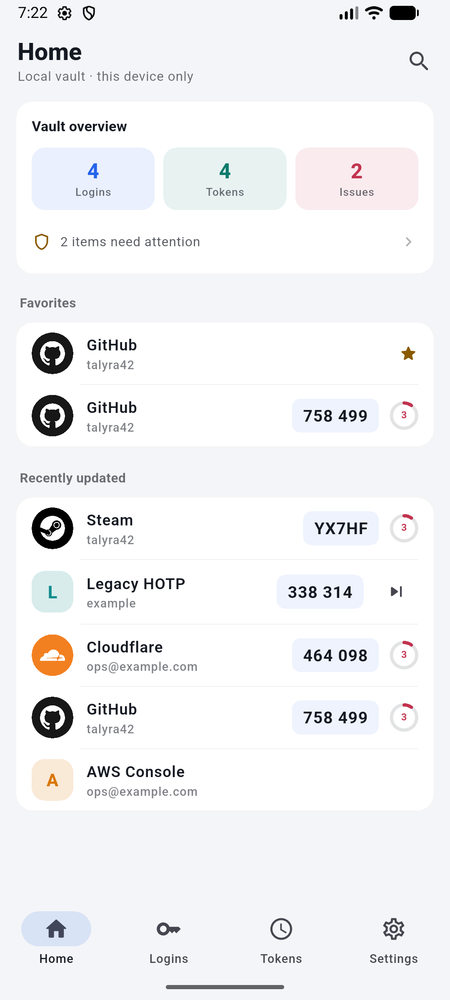
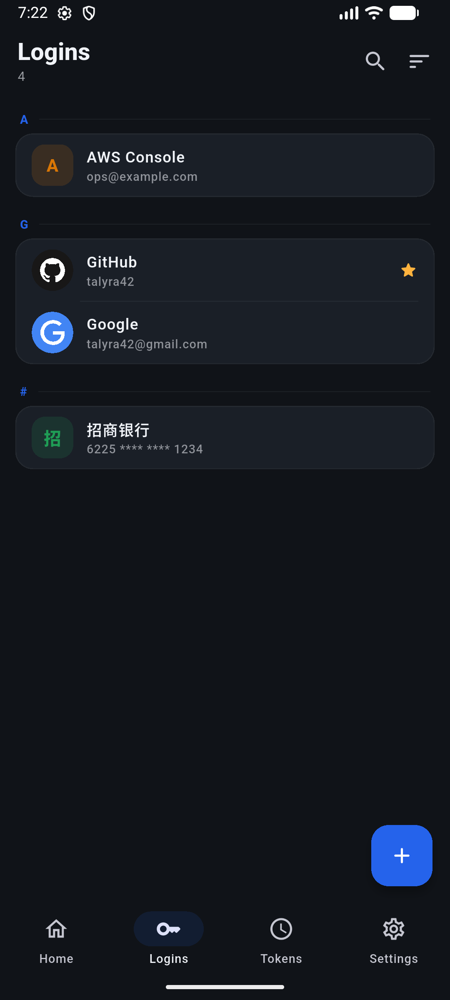
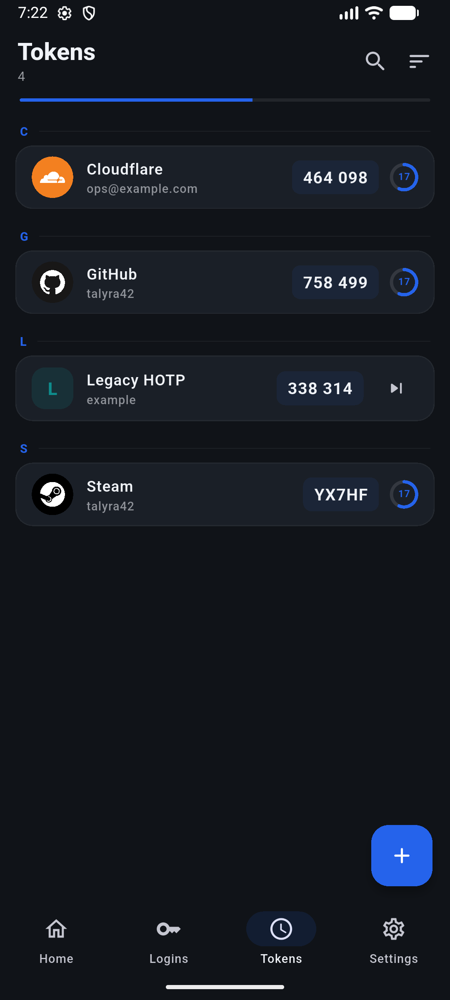
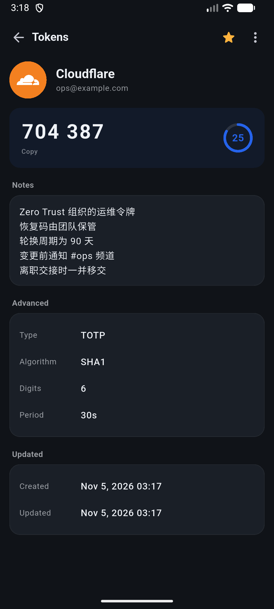
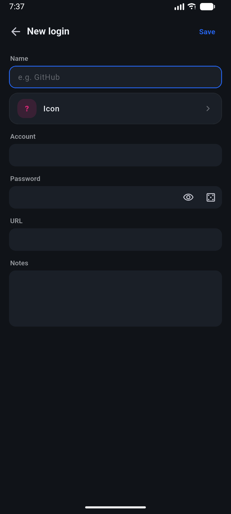
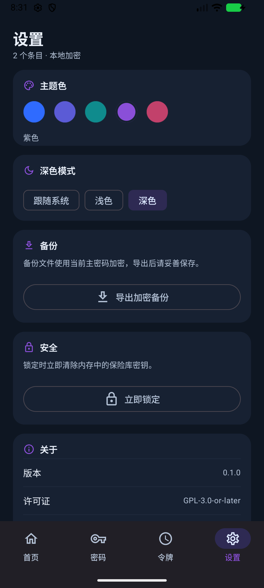

<div align="center">

# KeyCase

**A local-first password manager and TOTP authenticator for Android.**

No account. No cloud. No telemetry. One encrypted vault on your device.

[](https://github.com/LumiDesk/key-case/actions/workflows/ci.yaml)
[](LICENSE)


</div>

KeyCase stores logins, notes, and TOTP/HOTP/Steam codes in a single
`AES-256-GCM` container. A key derived from the master password with `Argon2id`
wraps a random 256-bit vault key, and the container is the only place where
entry data ever exists on disk. The app has no account system, no sync, and no
analytics; the only network request is the optional update check you trigger
from **Settings → About**.

## Screenshots

<table>
  <tr>
    <td align="center"><br /><sub>Home</sub></td>
    <td align="center"><br /><sub>Logins</sub></td>
    <td align="center"><br /><sub>Tokens</sub></td>
  </tr>
  <tr>
    <td align="center"><br /><sub>Token detail</sub></td>
    <td align="center"><br /><sub>Editor</sub></td>
    <td align="center"><br /><sub>Settings</sub></td>
  </tr>
</table>

## Features

| Area | What you get |
|---|---|
| **Vault** | Create with a master password, unlock, lock now, auto-lock when leaving the app |
| **Security** | Argon2id key derivation, AES-256-GCM, optional `FLAG_SECURE`, biometric unlock via Android Keystore |
| **Logins** | Account, password, URL, notes, random password generator, copy to clipboard |
| **Tokens** | TOTP, HOTP (with counter), Steam; one shared ticker, per-row countdown ring, next-code preview |
| **Lists** | A–Z grouping, search across names/accounts/URLs/notes, favorites, three sort orders |
| **Icons** | Bundled Aegis Simple Icons pack, automatic brand matching, searchable picker, custom image icons |
| **Imports** | Aegis JSON exports (plain or password-encrypted), Google Authenticator migration links, KeyCase backups |
| **Backups** | Encrypted `.kcbak` export/import; up to 10 automatic snapshots in a SAF folder you choose |
| **Cleanup** | Trash with restore and purge, security center for weak/reused/stale passwords |
| **Appearance** | System/light/dark, five accent presets, custom HSV color, Chinese/English |
| **Updates** | Manual "check for updates" against GitHub Releases; no background polling |

## Tech stack

| Layer | Choice |
|---|---|
| UI | Flutter 3.47.2, Material 3, project design tokens (`kc*` colors, radii, `KcPage` / `KcCard` / `KcHeader`) |
| State | `ChangeNotifier` + `InheritedNotifier`; no Provider/Riverpod/Bloc |
| Vault format | Single `KCV1` file: JSON + gzip payload, `AES-256-GCM`, 16-byte tag |
| Key derivation | `Argon2id` (64 MiB, 3 iterations, p=2) via `cryptography`; parameters stored in the container header |
| Native bridge | One `MethodChannel`: `FLAG_SECURE`, Android Keystore-wrapped vault key, SAF backup folder I/O |
| Biometrics | `local_auth` / `BiometricPrompt` with master-password fallback |
| QR scanning | `mobile_scanner` |
| Icons | `flutter_svg` + bundled Aegis Simple Icons pack |
| Preferences | `shared_preferences` (UI topics only; never vault data) |
| Backup I/O | `file_selector` + Storage Access Framework (`.kcbak`) |
| CI/CD | GitHub Actions, Flutter 3.47.2, signed `arm64` release APK |

## Architecture

```text
lib/
├── main.dart                    app entry, controller bootstrap, root routing
├── app/
│   ├── keycase_controller*.dart  single source of truth (ChangeNotifier)
│   ├── keycase_scope.dart        InheritedNotifier injection
│   ├── keycase_state.dart        UI state, error/notice codes
│   ├── vault/                    KCV1 container, repository, backups, queries
│   ├── crypto/                   Argon2id, AES-GCM, Base32, secure random
│   ├── otp/                      TOTP/HOTP/Steam and the app-wide clock
│   ├── import/                   otpauth, Aegis, Google migration
│   ├── icons/                    Aegis icon pack and SVG rendering
│   ├── security/                 weak/reused/stale password audit
│   ├── platform/                 native bridge and biometrics
│   ├── models/                   domain models and JSON mapping
│   ├── data/                     device preferences
│   ├── update/                   optional GitHub release check
│   ├── util/                     date, URL, and password helpers
│   ├── logging/                  AppLogger
│   └── app_theme.dart            design tokens and ThemeData
├── pages/                        screens; shared modal helpers live in sheets.dart
├── common_widgets.dart           shared widgets (parts under app/)
└── l10n/                         Chinese/English ARB files and generated code
android/                          Flutter host and the single native bridge
assets/iconpacks/                 Aegis Simple Icons (SVG + pack.json)
docs/                             design system, components, architecture, decisions
```

**Data flow**

1. `KeyCaseController.bootstrap()` reads preferences and checks for `vault.kcv`.
2. `VaultRepository` derives and verifies keys in a background isolate, then
   returns an in-memory `UnlockedVault`.
3. UI actions call controller methods; the controller builds the next
   `VaultData`, `VaultRepository.save()` serializes writes, and the container is
   replaced atomically (temp file + rename).
4. Locking clears the vault key and the in-memory data; the file stays encrypted.

## Security model

- **Encrypted at rest.** Entries only exist inside the `KCV1` container. The
  payload is gzip-compressed JSON encrypted with a random 256-bit vault key;
  the vault key is wrapped by a password key derived with Argon2id. The vault id
  is bound as AAD.
- **No plaintext on disk.** Master password, vault key, TOTP secrets, and entry
  contents are never written to logs, preferences, caches, or temporary files.
- **Biometric unlock.** The vault key is encrypted by a non-exportable Android
  Keystore key and stored in app-private preferences. The system BiometricPrompt
  gates every unlock; the master password remains the fallback.
- **No cloud backup.** `allowBackup="false"` keeps Android from copying the
  vault. Backups are encrypted container copies, exported through the system
  document picker.
- **No telemetry.** The only network call is a user-triggered request to
  `api.github.com` for the latest release. Nothing is uploaded.
- **No recovery.** A forgotten master password cannot be recovered; export a
  backup first. See [SECURITY.md](SECURITY.md) for the threat model.

## Build

Requirements: Flutter 3.47.2, Java 17, Android SDK (API 26+).

```bash
flutter pub get
flutter run -d emulator-5554
flutter build apk --debug
flutter build apk --release    # signed with signing/keycase-release.jks
```

Run the CI checks locally:

```bash
dart format --output=none --set-exit-if-changed .
flutter analyze
flutter test
flutter build apk --debug
```

For local UI checks, seed a demo vault and auto-unlock it:

```bash
flutter run -d emulator-5554 --dart-define=SEED_DEMO=true
```

## Release

Releases are built by GitHub Actions from a `vX.Y.Z` tag:

```bash
dart run scripts/publish.dart patch   # or minor / major
```

The script bumps `pubspec.yaml` and `lib/app/app_version.dart`, runs
format/analyze/test, commits, tags, and pushes. CI builds a signed `arm64` APK
and creates a **prerelease**. Promote it to latest after installing it on a
device.

## Project status

Current version: **1.0.5** (`1.0.5+10`). Only Android is supported. The
`android/` directory is the sole delivery target; there is no web or desktop
build. See [CHANGELOG.md](CHANGELOG.md) for user-visible changes.

## Documentation

- [AGENTS.md](AGENTS.md) — working rules, layout, and documentation sync policy
- [docs/design/design-system.md](docs/design/design-system.md) — colors, type, surfaces
- [docs/design/components.md](docs/design/components.md) — component and helper registry
- [docs/dev/architecture.md](docs/dev/architecture.md) — source navigation
- [docs/dev/testing.md](docs/dev/testing.md) — test layers and emulator checklist
- [docs/dev/tech-decisions.md](docs/dev/tech-decisions.md) — crypto, Keystore, format, backups
- [SECURITY.md](SECURITY.md) — threat model and reporting

## License

GPL-3.0-or-later. See [LICENSE](LICENSE).
